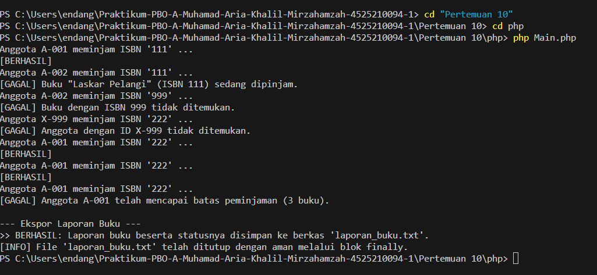

# Sistem Perpustakaan: Hierarki Exception dan Refactoring

Proyek ini adalah implementasi sistem peminjaman buku dalam dua bahasa, **Java** dan **PHP**. Fokus utamanya ada tiga:

1. Membuat hierarki exception domain yang membawa data penyebab kegagalan.
2. Mengubah method `pinjam()` dari nested if menjadi guard clause.
3. Menangkap dan menampilkan exception dengan tepat di lapisan layanan dan antarmuka.

| Informasi | Keterangan |
| :--- | :--- |
| **Nama** | Muhamad Aria Khalil Mirzahamzah |
| **NPM** | 4525210094 |
| **Kelas** | A |
| **Mata Kuliah** | Pemrograman Berbasis Objek (PBO) |
| **Materi** | Exception dan Refactoring (Pertemuan 10) |

---

## 1. Penjelasan Kode dan TODO

Bagian ini menjelaskan setiap TODO. Untuk setiap TODO ditampilkan kondisi **sebelum** (stub atau belum lengkap) dan **sesudah** (hasil akhir).

> **Catatan tentang gambar:** Screenshot before/after dari laporan tidak ikut diunggah, sehingga cuplikan "sebelum" di bawah disusun ulang dari instruksi TODO di setiap berkas. Gantilah atau tambahkan screenshot asli Anda di folder `before/` dan `after/` agar sesuai dengan referensi di laporan.

### 1.1 Folder exception (Java)

#### TODO 1: Memilih induk `PerpustakaanException`

Berkas: `PerpustakaanException.java`

Keputusan: diturunkan dari `RuntimeException` (unchecked).

**Before (belum ditentukan):**
```java
public abstract class PerpustakaanException extends Exception {
    // induk belum diputuskan
}
```

**After (keputusan final):**
```java
public abstract class PerpustakaanException extends RuntimeException {

    protected PerpustakaanException(String pesan) {
        super(pesan);
    }

    protected PerpustakaanException(String pesan, Throwable penyebab) {
        super(pesan, penyebab);
    }
}
```

**Alasan:** Semua kegagalan domain (anggota tidak terdaftar, ISBN tidak ada, stok habis, batas pinjam tercapai) berasal dari permintaan yang tidak sesuai aturan, bukan dari keadaan luar seperti jaringan atau berkas. Jika checked, setiap method seperti `pinjam()` harus mendeklarasikan `throws` dan setiap pemanggil dipaksa menangani exception. Dengan unchecked, kode lebih ringkas, dan konsisten dengan PHP yang tidak punya checked exception. Alasan lengkapnya juga dituliskan di `skenario-uji.md`.

#### TODO 2–4: Atribut, konstruktor, dan getter `BukuTidakDitemukanException`

Berkas: `BukuTidakDitemukanException.java`

**Before (belum lengkap):**
```java
public class BukuTidakDitemukanException extends PerpustakaanException {
    public BukuTidakDitemukanException(String isbn) {
        // belum ada super(...), atribut, dan getter
    }
}
```
Kode ini tidak bisa dikompilasi, karena `PerpustakaanException` tidak punya konstruktor tanpa argumen dan tidak ada pesan yang dikirim ke induknya.

**After (lengkap):**
```java
public class BukuTidakDitemukanException extends PerpustakaanException {

    private final String isbn;

    public BukuTidakDitemukanException(String isbn) {
        super("Buku dengan ISBN " + isbn + " tidak ditemukan");
        this.isbn = isbn;
    }

    public String getIsbn() {
        return this.isbn;
    }
}
```

**Penjelasan:** Pesan dikirim ke `super(...)` sehingga `getMessage()` tetap bisa dibaca. Data ISBN disimpan di atribut sehingga pemanggil bisa mengambilnya lewat `getIsbn()` tanpa harus mengurai teks pesan. Pola inilah yang nantinya menjadi isi respons HTTP 404 pada sesi berikutnya.

#### TODO: Mengikuti pola `BukuTidakDitemukanException`

Berkas: `AnggotaTidakDitemukanException.java`

**Before:** kelas hanya berisi kerangka, belum ada atribut `idAnggota` dan getter.

**After:**
```java
public class AnggotaTidakDitemukanException extends PerpustakaanException {

    private final String idAnggota;

    public AnggotaTidakDitemukanException(String idAnggota) {
        super("Anggota dengan ID " + idAnggota + " tidak ditemukan");
        this.idAnggota = idAnggota;
    }

    public String getIdAnggota() {
        return this.idAnggota;
    }
}
```

**Penjelasan:** Polanya sama dengan exception buku. Pemanggil dapat mengetahui anggota mana yang bermasalah melalui `getIdAnggota()`.

#### TODO: Membawa dua data (isbn dan judul)

Berkas: `BukuSedangDipinjamException.java`

**Before:**
```java
public BukuSedangDipinjamException(String isbn) {
    super("Buku dengan ISBN " + isbn + " sedang dipinjam");
    this.isbn = isbn;
}
```
Judul belum ikut disimpan, sehingga pesan untuk pengguna hanya memuat ISBN.

**After:**
```java
public class BukuSedangDipinjamException extends PerpustakaanException {

    private final String isbn;
    private final String judul;

    public BukuSedangDipinjamException(String isbn, String judul) {
        super("Buku " + judul + " dengan ISBN " + isbn + " sedang dipinjam");
        this.isbn = isbn;
        this.judul = judul;
    }

    public String getIsbn()  { return this.isbn; }
    public String getJudul() { return this.judul; }
}
```

**Penjelasan:** Judul disertakan agar pesan untuk pengguna lebih bermakna, sedangkan ISBN tetap disimpan agar sistem bisa mengolahnya.

#### TODO: Membawa idAnggota dan batas

Berkas: `BatasPinjamTerlampauiException.java`

**Before:**
```java
public BatasPinjamTerlampauiException(String idAnggota) {
    super("Anggota dengan ID " + idAnggota + " telah mencapai batas maksimum peminjaman");
    this.idAnggota = idAnggota;
}
```
Pemanggil di `LibraryService` mengirim dua argumen, sehingga kode ini gagal dikompilasi.

**After:**
```java
public BatasPinjamTerlampauiException(String idAnggota, int batas) {
    super("Anggota dengan ID " + idAnggota + " telah mencapai batas maksimum peminjaman");
    this.idAnggota = idAnggota;
    this.batas = batas;
}

public int getBatas() {
    return this.batas;
}
```

**Penjelasan:** Batas maksimum disimpan di dalam exception. Pemanggil bisa menyusun pesan tanpa perlu mengetahui konstanta `BATAS_PINJAM` secara langsung.

---

### 1.2 Folder service (Java): Refactoring `pinjam()`

Berkas: `LibraryServiceKotor.java` (sebelum) dan `LibraryService.java` (sesudah)

**Before (bersarang empat tingkat):**
```java
public boolean pinjam(String idAnggota, String isbn) {
    if (pinjaman.containsKey(idAnggota)) {
        if (stok.containsKey(isbn)) {
            if (stok.get(isbn) > 0) {
                if (pinjaman.get(idAnggota) < BATAS_PINJAM) {
                    stok.merge(isbn, -1, Integer::sum);
                    pinjaman.merge(idAnggota, 1, Integer::sum);
                    return true;
                } else {
                    return false;   // kenapa gagal? pemanggil tidak tahu
                }
            } else {
                return false;
            }
        } else {
            return false;
        }
    } else {
        return false;
    }
}
```

**After (guard clause dengan exception spesifik):**
```java
public boolean pinjam(String idAnggota, String isbn) {
    if (!pinjaman.containsKey(idAnggota)) {
        throw new AnggotaTidakDitemukanException(idAnggota);
    }

    if (!stok.containsKey(isbn)) {
        throw new BukuTidakDitemukanException(isbn);
    }

    if (stok.get(isbn) <= 0) {
        throw new BukuSedangDipinjamException(isbn, judul.get(isbn));
    }

    if (pinjaman.get(idAnggota) >= BATAS_PINJAM) {
        throw new BatasPinjamTerlampauiException(idAnggota, BATAS_PINJAM);
    }

    stok.merge(isbn, -1, Integer::sum);
    pinjaman.merge(idAnggota, 1, Integer::sum);
    return true;
}
```

**Penjelasan:**

- Pada versi awal, logika utama berada di empat tingkat kondisi, dan setiap kegagalan hanya menghasilkan `false` tanpa alasan. Pemanggil tidak bisa membedakan anggota yang salah dengan buku yang habis.
- Pada versi refaktor, setiap pemeriksaan ditulis sebagai guard clause yang berdiri sendiri dan melempar exception sesuai penyebabnya. Logika utama berada di baris paling akhir tanpa menjorok.
- Menambahkan satu aturan baru cukup dengan satu blok `if` di posisi yang sesuai, tanpa perlu membongkar struktur yang sudah ada.

**Urutan pemeriksaan** juga penting. Anggota diperiksa dulu, kemudian buku, stok, dan batas pinjam. Urutan ini mengikuti skenario uji di `skenario-uji.md`.

---

### 1.3 File `PerpustakaanService.java`: Menangkap exception

**Before (hanya mencetak pesan tanpa data):**
```java
} catch (PerpustakaanException e) {
    System.out.println("[Error Domain] " + e.getMessage());
}
```
Data spesifik seperti ISBN atau batas pinjam tidak ditampilkan, dan tidak ada pemisahan antara kesalahan domain dan kesalahan pemrograman.

**After:**
```java
} catch (PerpustakaanException e) {
    System.out.println("[Error Domain] " + e.getMessage());

    if (e instanceof BukuTidakDitemukanException ex) {
        System.out.println("ISBN bermasalah: " + ex.getIsbn());
    } else if (e instanceof AnggotaTidakDitemukanException ex) {
        System.out.println("Id Anggota bermasalah: " + ex.getIdAnggota());
    } else if (e instanceof BukuSedangDipinjamException ex) {
        System.out.println("  -> Judul Buku: " + ex.getJudul() + " (ISBN: " + ex.getIsbn() + ")");
    } else if (e instanceof BatasPinjamTerlampauiException ex) {
        System.out.println("  -> Batas Maksimum: " + ex.getBatas() + " buku");
    }
} catch (Exception e) {
    System.out.println("[Error Sistem] Terjadi kesalahan input " + e.getMessage());
}
```

**Penjelasan:** `catch (PerpustakaanException e)` menangkap seluruh kegagalan domain sekaligus. Di dalamnya, `instanceof` dengan pattern matching (Java 16+) memilih data yang ditampilkan sesuai jenis exception. Blok `catch (Exception e)` terpisah menangani kesalahan lain, sehingga kesalahan pemrograman tidak ikut tertelan oleh penanganan domain.

---

### 1.4 File `Main.java`: Menu dan ekspor laporan

**Before:** menu belum lengkap dan laporan belum diekspor.

**After:** menu utama memakai `switch` dengan nilai `String`, dan metode `eksporLaporan()` menulis `laporan_buku.txt`:

```java
try (PrintWriter writer = new PrintWriter(new FileWriter(namaFile))) {
    // ... penulisan header dan baris buku ...
} catch (IOException e) {
    System.out.println("[ERROR FILE] Gagal menulis laporan ke berkas: " + e.getMessage());
}
```

**Penjelasan:** `try-with-resources` menutup `PrintWriter` secara otomatis walaupun terjadi error. Status buku ditentukan dari sisa stok: "Tersedia" jika lebih dari 0.

---

### 1.5 Folder exception (PHP): Constructor property promotion

Berkas: `BukuTidakDitemukanException.php`, `AnggotaTidakDitemukanException.php`, `BukuSedangDipinjamException.php`, `BatasPinjamTerlampauiException.php`

**Before (penugasan manual di badan konstruktor):**
```php
final class BukuTidakDitemukanException extends PerpustakaanException
{
    private string $isbn;

    public function __construct(string $isbn)
    {
        parent::__construct("Buku dengan ISBN {$isbn} tidak ditemukan.");
        $this->isbn = $isbn;
    }

    public function getIsbn(): string
    {
        return $this->isbn;
    }
}
```

**After (constructor property promotion dengan `readonly`):**
```php
final class BukuTidakDitemukanException extends PerpustakaanException
{
    public function __construct(private readonly string $isbn)
    {
        parent::__construct("Buku dengan ISBN {$isbn} tidak ditemukan.");
    }

    public function getIsbn(): string
    {
        return $this->isbn;
    }
}
```

**Penjelasan:** Parameter konstruktor langsung menjadi properti. Properti `readonly` memastikan nilainya tidak berubah setelah exception dibuat. Kelas ditandai `final` karena tidak perlu diturunkan lagi. Pola ini sejalan dengan versi Java.

Untuk `BatasPinjamTerlampauiException` dan `BukuSedangDipinjamException`, pola yang sama dipakai untuk dua parameter:

```php
public function __construct(
    private readonly string $isbn,
    private readonly string $judul,
) {
    parent::__construct("Buku \"{$judul}\" (ISBN {$isbn}) sedang dipinjam.");
}
```

---

### 1.6 Folder service (PHP): Refactoring `pinjam()`

Berkas: `LibraryServiceKotor.php` (sebelum) dan `LibraryService.php` (sesudah)

**Before:**
```php
public function pinjam(string $idAnggota, string $isbn): bool
{
    if (array_key_exists($idAnggota, $this->pinjaman)) {
        if (array_key_exists($isbn, $this->stok)) {
            if ($this->stok[$isbn] > 0) {
                if ($this->pinjaman[$idAnggota] < self::BATAS_PINJAM) {
                    $this->stok[$isbn]--;
                    $this->pinjaman[$idAnggota]++;
                    return true;
                } else {
                    return false;
                }
            } else {
                return false;
            }
        } else {
            return false;
        }
    } else {
        return false;
    }
}
```

**After:**
```php
/**
 * @throws AnggotaTidakDitemukanException jika anggota belum terdaftar
 * @throws BukuTidakDitemukanException    jika ISBN tidak ada di katalog
 * @throws BukuSedangDipinjamException    jika tidak ada eksemplar tersisa
 * @throws BatasPinjamTerlampauiException jika anggota sudah mencapai batas
 */
public function pinjam(string $idAnggota, string $isbn): void
{
    if (!array_key_exists($idAnggota, $this->pinjaman)) {
        throw new AnggotaTidakDitemukanException($idAnggota);
    }

    if (!array_key_exists($isbn, $this->stok)) {
        throw new BukuTidakDitemukanException($isbn);
    }

    if ($this->stok[$isbn] <= 0) {
        throw new BukuSedangDipinjamException($isbn, $this->judul[$isbn]);
    }

    if ($this->pinjaman[$idAnggota] >= self::BATAS_PINJAM) {
        throw new BatasPinjamTerlampauiException($idAnggota, self::BATAS_PINJAM);
    }

    $this->stok[$isbn]--;
    $this->pinjaman[$idAnggota]++;
}
```

**Penjelasan:**

- Strukturnya sama dengan versi Java. Perbedaannya, PHP memakai `array_key_exists()` untuk memeriksa keberadaan kunci.
- Method bertipe `void` karena keberhasilan ditandai oleh tidak adanya exception.
- Karena PHP tidak punya checked exception, anotasi `@throws` pada PHPDoc menjadi dokumentasi kontrak yang penting, sebab kompilator tidak membantu pembaca kode.
- Konstanta `BATAS_PINJAM` memakai typed class constant (`public const int`), fitur yang tersedia sejak PHP 8.3.

---

### 1.7 File `main.php`: Skenario uji dan ekspor laporan

`main.php` menjalankan lima skenario uji (lihat bagian 2). Setiap percobaan dibungkus `try`, dan `catch (PerpustakaanException $e)` menampilkan pesan kegagalan.

Fungsi `createReport()` membuka berkas dengan `fopen()`, menulis laporan, dan menutup berkas di blok `finally` sehingga berkas selalu tertutup walaupun terjadi error di tengah penulisan.

---

## 2. Skenario Uji

Skenario berikut dijalankan oleh `main.php` dan dijelaskan di `skenario-uji.md`.

| No | Input (ID anggota, ISBN) | Kondisi | Exception yang diharapkan |
|----|--------------------------|---------|---------------------------|
| 1 | A-001, 111 | Anggota ada, buku ada, stok > 0, pinjaman < 3 | Berhasil |
| 2 | A-002, 111 | Stok buku 111 sudah 0 | `BukuSedangDipinjamException` |
| 3 | A-002, 999 | ISBN tidak ada di katalog | `BukuTidakDitemukanException` |
| 4 | X-999, 222 | Anggota belum terdaftar | `AnggotaTidakDitemukanException` |
| 5 | A-001, 222 (sampai pinjaman = 3) | Batas tercapai | `BatasPinjamTerlampauiException` |

Skenario 5 membutuhkan tiga kali peminjaman buku 222 oleh A-001 agar batas tercapai. Pada percobaan pertama A-001 meminjam buku 111, sehingga pinjaman A-001 sudah berjumlah 1 sebelum meminjam buku 222 dua kali.

---

## 3. Keputusan Desain

| Keputusan | Alasan |
|-----------|--------|
| `PerpustakaanException` turunan `RuntimeException` | Kegagalan domain bukan keadaan luar yang wajar, dan konsisten dengan PHP |
| Exception membawa data penyebab | Pemanggil tidak perlu mengurai teks pesan, dan data bisa dipakai untuk respons HTTP |
| Guard clause pada `pinjam()` | Alur lebih datar dan aturan baru mudah ditambahkan |
| Penangkapan dengan `catch` khusus domain dan `catch` umum terpisah | Kesalahan pemrograman tidak ikut tertelan |
| `readonly` dan `final` di PHP | Data exception tidak bisa diubah setelah dibuat, dan kelas tidak diturunkan lagi |

---

## 4. Cara Menjalankan

**Java**

```bash
javac -d out $(find java -name "*.java")
java -cp out id.ac.univpancasila.perpustakaan.Main
```

**PHP** (memerlukan Composer untuk autoload dan Carbon)

```bash
composer install
php php/Main.php
```

Setelah program selesai, berkas `laporan_buku.txt` akan dibuat di direktori yang sama dengan program.

### Tampilan Output

**Java**


.png)

**PHP**



> Screenshot di atas diambil dari hasil menjalankan program. Simpan file tangkapan layar Anda dengan nama dan lokasi yang sama seperti di atas (`output/java/P10_OutputJava.png` dan `output/php/P10_OutputPHP.png`) agar gambar tampil di README.

---

## 5. Catatan dan Perbaikan yang Disarankan

Beberapa hal yang ditemukan saat meninjau kode dan bisa diperbaiki sebelum pengumpulan:

1. **`PerpustakaanService.pinjamBuku()` (Java):** Saat ID anggota kosong, program hanya menampilkan peringatan lalu tetap melanjutkan ke input ISBN. Tambahkan `continue;` setelah peringatan tersebut.
2. **`Main.php`:** Komentar di `LibraryService.php` menyebut demo hanya berjalan jika file dijalankan langsung, tetapi demo sebenarnya berada di `Main.php` dan dijalankan di level atas. Sesuaikan komentarnya.
3. **`Main.php`:** Import `Mahasiswa` dan `Jurusan` tidak dipakai. Hapus agar kode lebih bersih.
4. **`PerpustakaanException.php`:** Ada typo pada docblock (`ewdd` dan `PbHPDoc`).
5. **`BukuSedangDipinjamException.java`:** Pesan memiliki spasi ganda setelah `ISBN`.
6. **`LibraryService.getSemuaJudul()` (Java):** Method ini mengembalikan map internal secara langsung, sehingga pemanggil bisa mengubahnya. Pertimbangkan mengembalikan salinan (`Map.copyOf(judul)`).
7. **Laporan praktikum:** Header laporan menulis "Pertemuan 8 - Komposisi dan Agregasi", tetapi isi materinya adalah Pertemuan 10 (Exception dan Refactoring). Sesuaikan judul pertemuan.
8. **`main.php` (skenario uji):** Komentar `// buku habi` seharusnya `// buku habis`.

---

## 6. Kesimpulan

Dengan membuat hierarki exception domain, kegagalan peminjaman ditangani melalui satu induk, dan setiap penyebab memiliki tipe sendiri yang membawa datanya. Pemanggil tidak lagi perlu menebak alasan dari nilai `false`.

Refactoring dari nested if menjadi guard clause membuat alur logika lebih mudah dibaca, dan aturan baru dapat ditambahkan dengan lebih aman. Perbedaan utama Java dan PHP terletak pada tipe exception. Java memakai unchecked exception melalui `RuntimeException`, sedangkan PHP tidak memiliki checked exception sehingga dokumentasi `@throws` menjadi sangat penting.

