# LAPORAN PRAKTIKUM PEMROGRAMAN BERBASIS OBJEK

| Informasi Praktikan | Keterangan |
| :--- | :--- |
| **Nama** | Muhamad Aria Khalil Mirzahamzah |
| **NPM** | 4525210094 |
| **Kelas** | A |
| **Mata Kuliah** | Pemrograman Berbasis Objek (PBO) |
| **Pertemuan** | 7 - Komposisi dan Agregasi |
| **Tanggal** | [ 17/10/2026 ] |

---

## 1. Implementasi Java

### 1.1. File: `model/Buku.java`

**TODO 1: Validasi jumlah eksemplar pada constructor**

* **Before** *(Kondisi awal / Galat logika)*:
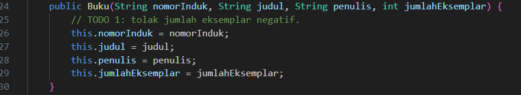

* **After** *(Kondisi akhir / Eksekusi berhasil)*:
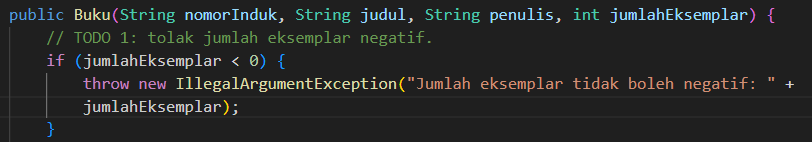

**Penjelasan:**
> Constructor menolak jumlah eksemplar negatif dengan melempar `IllegalArgumentException`. Pemeriksaan dilakukan sebelum field diisi, sehingga objek `Buku` tidak pernah berada dalam kondisi yang tidak valid.

**TODO 2: Method `tambahBab(int nomor, String judulBab)`**

* **Before** *(Kondisi awal / Galat logika)*:
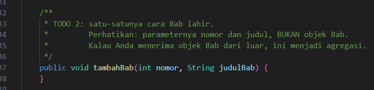

* **After** *(Kondisi akhir / Eksekusi berhasil)*:
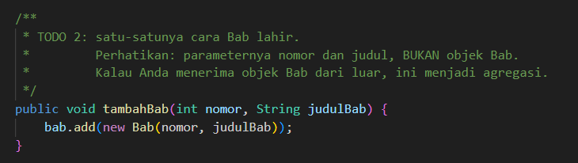

**Penjelasan:**
> Method menerima nomor dan judul, bukan objek `Bab`. Objek `Bab` dibuat di dalam `Buku` sehingga tidak ada cara lain untuk membuatnya dari luar. Inilah yang membuat relasi ini komposisi.

**TODO 3: Method `getBab()` mengembalikan salinan tak-berubah**

* **Before** *(Kondisi awal / Galat logika)*:
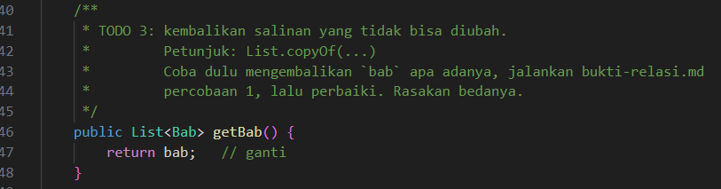

* **After** *(Kondisi akhir / Eksekusi berhasil)*:
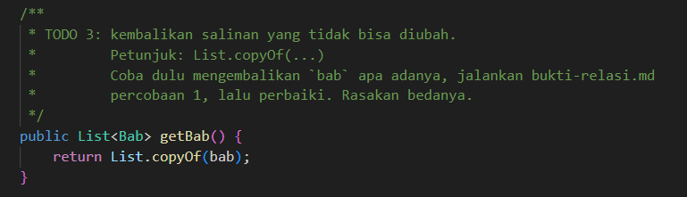

**Penjelasan:**
> Sebelum diperbaiki, `getBab()` mengembalikan list internal sehingga `clear()` dari luar berhasil menghapus isi buku. Setelah memakai `List.copyOf(bab)`, pemanggilan `clear()` melempar `UnsupportedOperationException`, dan komposisi tetap terjaga.

**TODO 4: Method `kurangiStok()`**

* **Before** *(Kondisi awal / Galat logika)*:
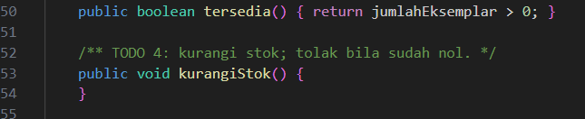

* **After** *(Kondisi akhir / Eksekusi berhasil)*:
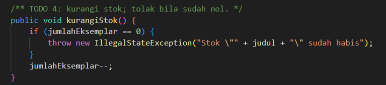

**Penjelasan:**
> Method mengurangi stok satu, dan melempar `IllegalStateException` jika stok sudah nol.

**Kode Lengkap:**
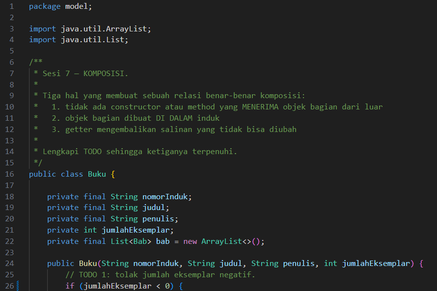

### 1.2. File: `model/Jurusan.java`

**TODO 1: Method `daftarkan(Mahasiswa m)`**

* **Before** *(Kondisi awal / Galat logika)*:
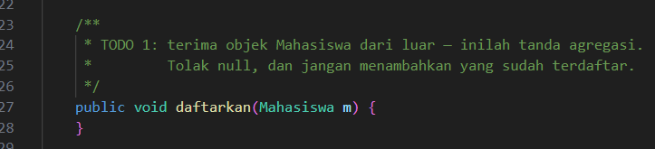

* **After** *(Kondisi akhir / Eksekusi berhasil)*:
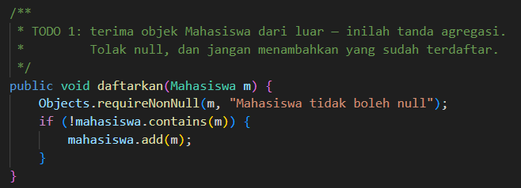

**Penjelasan:**
> Objek `Mahasiswa` datang dari luar, itulah tanda agregasi. Method menolak `null` dengan `Objects.requireNonNull` dan tidak menambahkan mahasiswa yang sudah terdaftar.

**TODO 2: Method `keluarkan(Mahasiswa m)`**

* **Before** *(Kondisi awal / Galat logika)*:
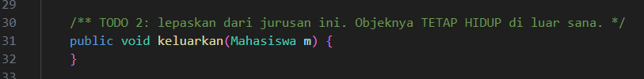

* **After** *(Kondisi akhir / Eksekusi berhasil)*:
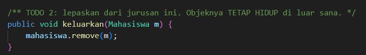

**Penjelasan:**
> Method hanya melepas referensi dari daftar. Objek `Mahasiswa` tetap hidup di luar jurusan, sesuai sifat agregasi.

**TODO 3: Method `getMahasiswa()` mengembalikan salinan tak-berubah**

* **Before** *(Kondisi awal / Galat logika)*:
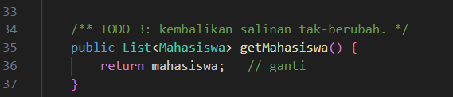

* **After** *(Kondisi akhir / Eksekusi berhasil)*:
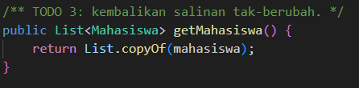

**Penjelasan:**
> Sama seperti `Buku.getBab()`, method ini mengembalikan `List.copyOf(mahasiswa)` agar daftar internal tidak bisa diubah dari luar.

**Kode Lengkap:**
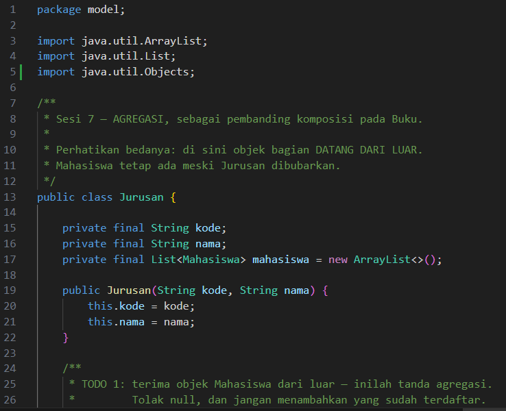

### 1.3. File: `service/PerpustakaanService.java`

**TODO 1: Keputusan agregasi atau komposisi**

* **Before** *(Kondisi awal / Belum ada penyimpanan koleksi)*:
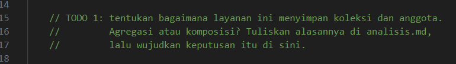

* **After** *(Kondisi akhir / Keputusan agregasi diwujudkan)*:
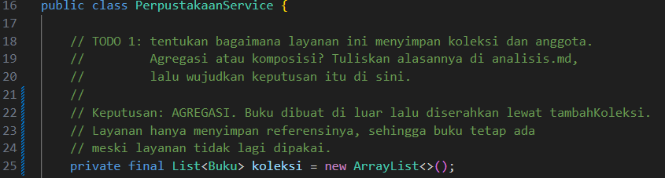

**Penjelasan:**
> Keputusan: **agregasi**. Buku dibuat di luar layanan lalu diserahkan lewat `tambahKoleksi()`. Layanan hanya menyimpan referensinya sehingga buku tetap ada meski layanan tidak dipakai lagi.

**TODO 2: Method `tambahKoleksi(Buku buku)`**

* **Before** *(Kondisi awal / Galat logika)*:
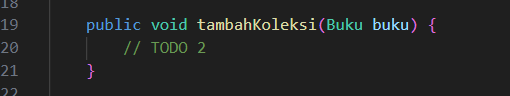

* **After** *(Kondisi akhir / Eksekusi berhasil)*:
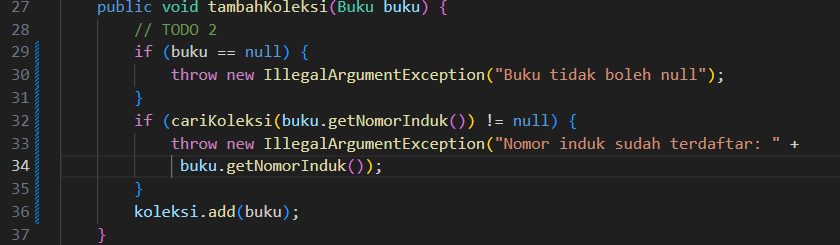

**Penjelasan:**
> Method menolak `null` dan nomor induk yang sudah terdaftar, lalu menambahkan buku ke daftar koleksi.

**TODO 3: Method `cariKoleksi(String nomorInduk)`**

* **Before** *(Kondisi awal / Galat logika)*:
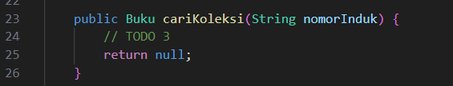

* **After** *(Kondisi akhir / Eksekusi berhasil)*:
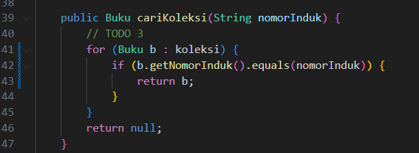

**Penjelasan:**
> Method menelusuri koleksi dan mengembalikan buku yang nomor induknya cocok, atau `null` jika tidak ditemukan.

**TODO 4: Method `pinjam(nomorAnggota, nomorInduk)`**

* **Before** *(Kondisi awal / Galat logika)*:
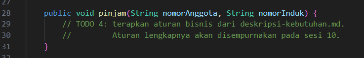

* **After** *(Kondisi akhir / Eksekusi berhasil)*:
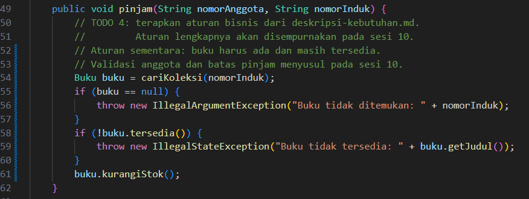

**Penjelasan:**
> Aturan sementara: buku harus ada dan masih tersedia, lalu stoknya dikurangi. Validasi anggota dan batas pinjam akan ditambahkan pada sesi 10.

**TODO 5: Method `kembalikan(nomorAnggota, nomorInduk)`**

* **Before** *(Kondisi awal / Galat logika)*:
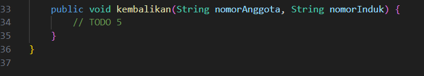

* **After** *(Kondisi akhir / Eksekusi berhasil)*:
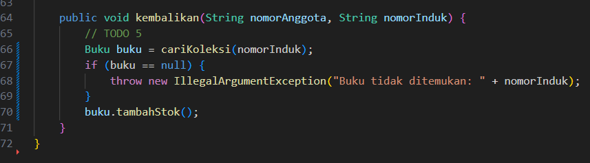

**Penjelasan:**
> Method mencari buku lalu menambah stoknya kembali.

**Kode Lengkap:**
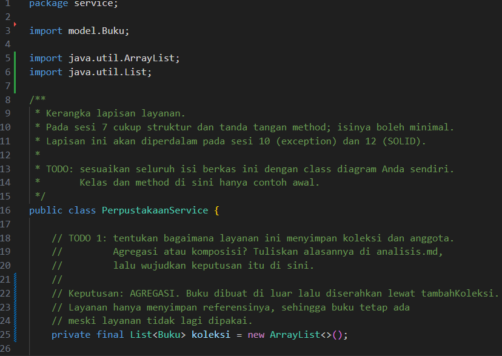

### 1.4. File: `Main.java`

* Tidak ada TODO. Program mendemonstrasikan komposisi (`Buku` dan `Bab`) dan agregasi (`Jurusan` dan `Mahasiswa`).

**Output Program:**
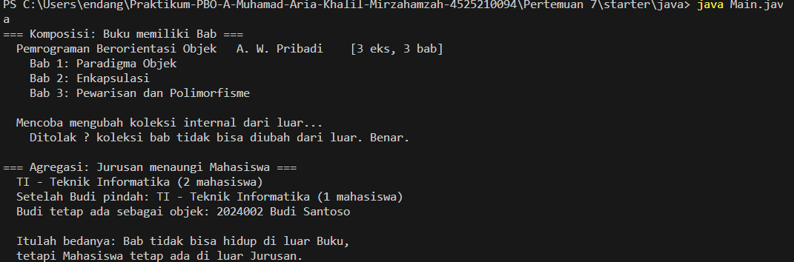

**Penjelasan:**
> Percobaan mengosongkan koleksi bab dari luar ditolak, yang membuktikan `getBab()` sudah mengembalikan salinan tak-berubah. Setelah Budi dikeluarkan dari jurusan, objek `Budi` tetap ada, yang membuktikan agregasi.

---

## 2. Implementasi PHP

### 2.1. File: `relasi.php`

**TODO 1: Constructor `readonly` pada `Bab`**

* **Before** *(Kondisi awal / Galat logika)*:
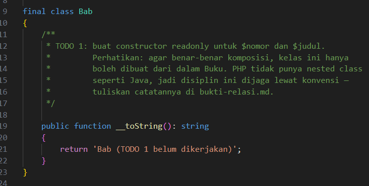

* **After** *(Kondisi akhir / Eksekusi berhasil)*:
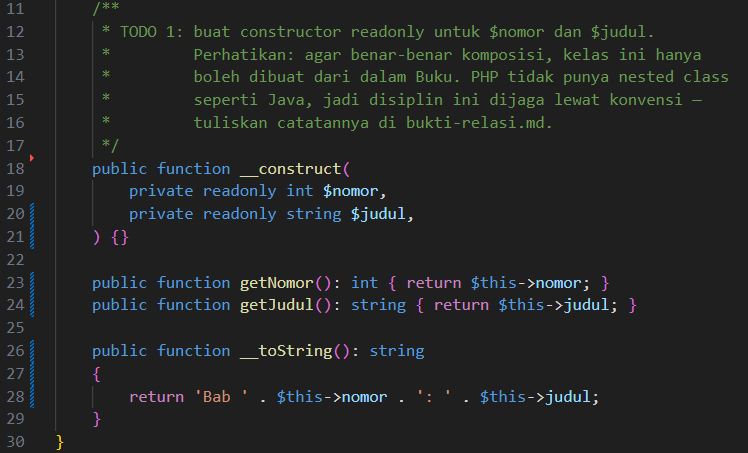

**Penjelasan:**
> Properti `$nomor` dan `$judul` dibuat `readonly` agar tidak bisa diubah setelah objek dibuat. PHP tidak punya nested class, sehingga pembatasan bahwa `Bab` hanya dibuat dari `Buku` dijaga lewat konvensi.

**TODO 2: Validasi jumlah eksemplar pada `Buku`**

* **Before** *(Kondisi awal / Galat logika)*:
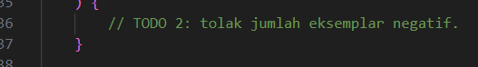

* **After** *(Kondisi akhir / Eksekusi berhasil)*:
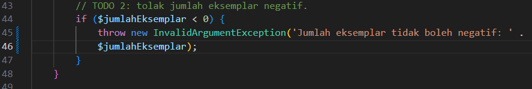

**Penjelasan:**
> Constructor melempar `InvalidArgumentException` jika jumlah eksemplar negatif.

**TODO 3: Method `tambahBab(int $nomor, string $judulBab)`**

* **Before** *(Kondisi awal / Galat logika)*:
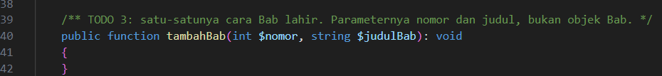

* **After** *(Kondisi akhir / Eksekusi berhasil)*:
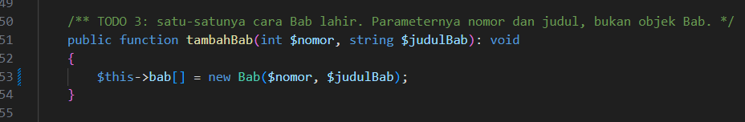

**Penjelasan:**
> Method membuat `Bab` baru dari nomor dan judul, sama seperti versi Java.

**TODO 4: Method `kurangiStok()`**

* **Before** *(Kondisi awal / Galat logika)*:
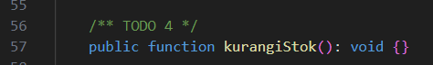

* **After** *(Kondisi akhir / Eksekusi berhasil)*:
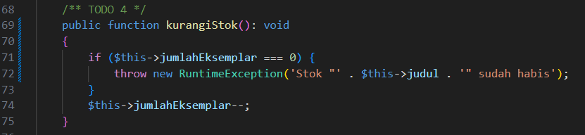

**Penjelasan:**
> Method melempar `RuntimeException` jika stok sudah nol.

**TODO 5: Method `daftarkan(Mahasiswa $m)`**

* **Before** *(Kondisi awal / Galat logika)*:
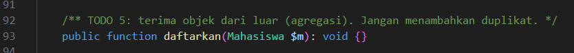

* **After** *(Kondisi akhir / Eksekusi berhasil)*:
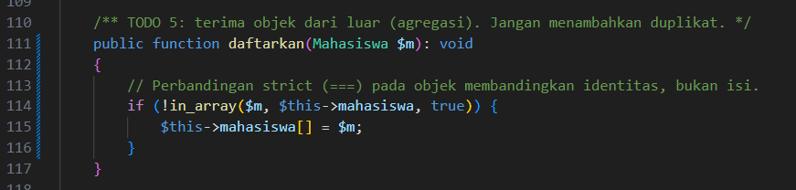

**Penjelasan:**
> Perbandingan `in_array(..., true)` membandingkan identitas objek, sehingga mahasiswa yang sama tidak masuk dua kali.

**TODO 6: Method `keluarkan(Mahasiswa $m)`**

* **Before** *(Kondisi awal / Galat logika)*:
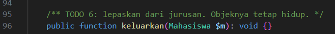

* **After** *(Kondisi akhir / Eksekusi berhasil)*:
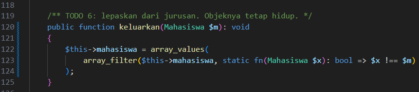

**Penjelasan:**
> Mahasiswa dibuang dari array dengan `array_filter`, lalu indeksnya dirapikan dengan `array_values`. Objeknya tetap hidup di luar jurusan.

**Kode Lengkap:**
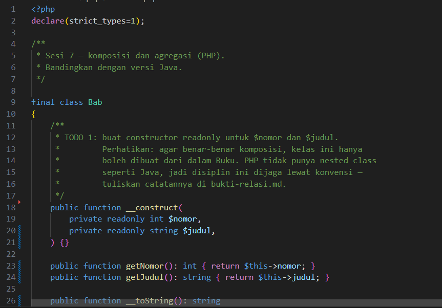

### 2.2. File: `main.php`

* Tidak ada TODO. Program mencetak hasil komposisi dan agregasi dengan cara yang sama seperti `Main.java`.

**Output Program:**
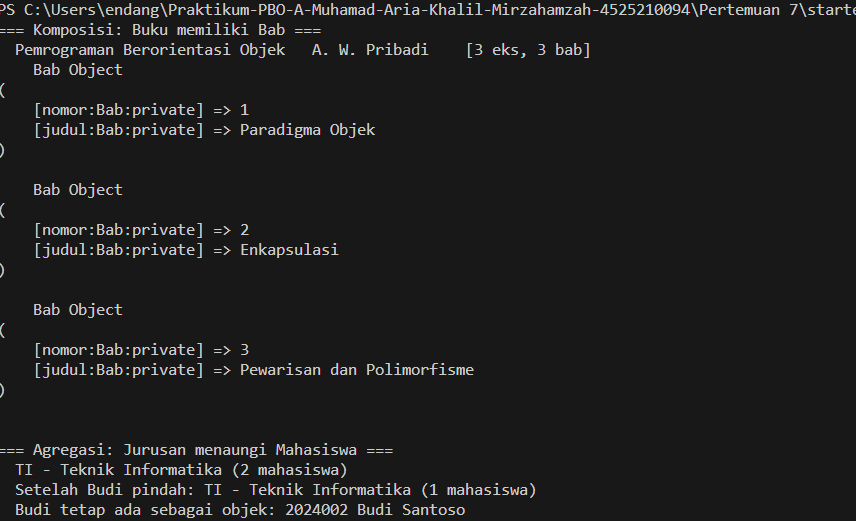

---

## 3. Class Diagram (PlantUML)

File: `perpustakaan-kerangka.puml`

**TODO 1: Tiga turunan `Koleksi`**

* **Before** *(Kondisi awal / Belum ada turunan)*:
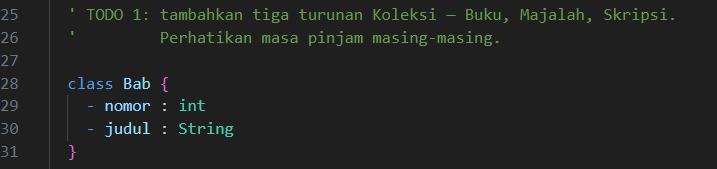

* **After** *(Kondisi akhir / Turunan ditambahkan)*:
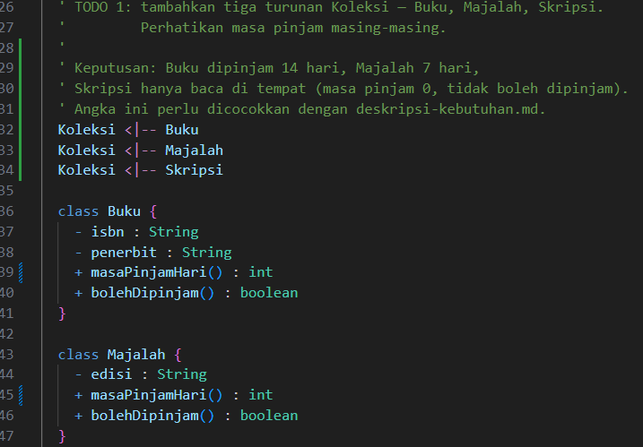
.png)

**Penjelasan:**
> `Buku`, `Majalah`, dan `Skripsi` diturunkan dari `Koleksi`. Masa pinjam Buku 14 hari, Majalah 7 hari, dan Skripsi hanya baca di tempat sehingga tidak boleh dipinjam.

**TODO 2: Kelas `Anggota` dan `Peminjaman`**

* **Before** *(Kondisi awal / Kelas belum ada)*:
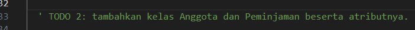

* **After** *(Kondisi akhir / Kelas ditambahkan)*:
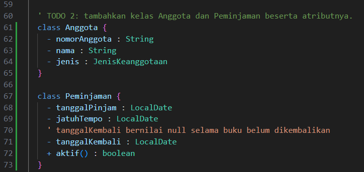

**Penjelasan:**
> Ditambahkan kelas `Anggota` dengan atribut nomor anggota, nama, dan jenis. Kelas `Peminjaman` dengan atribut tanggal pinjam, jatuh tempo, dan tanggal kembali.

**TODO 3: Enum `StatusKoleksi` dan `JenisKeanggotaan`**

* **Before** *(Kondisi awal / Enum belum ada)*:
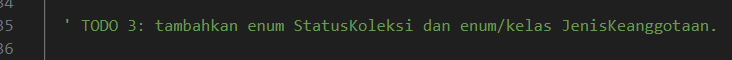

* **After** *(Kondisi akhir / Enum ditambahkan)*:
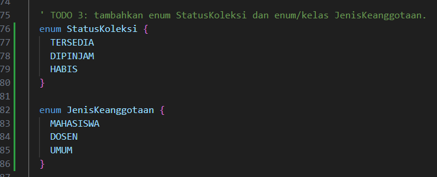

**Penjelasan:**
> `StatusKoleksi` berisi `TERSEDIA`, `DIPINJAM`, dan `HABIS`. `JenisKeanggotaan` berisi `MAHASISWA`, `DOSEN`, dan `UMUM`.

**TODO 4: Derajat keterikatan dan multiplicity**

* **Before** *(Kondisi awal / Relasi belum diisi)*:
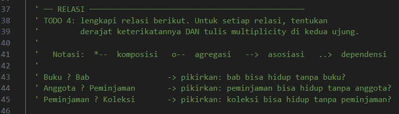

* **After** *(Kondisi akhir / Relasi lengkap dengan multiplicity)*:
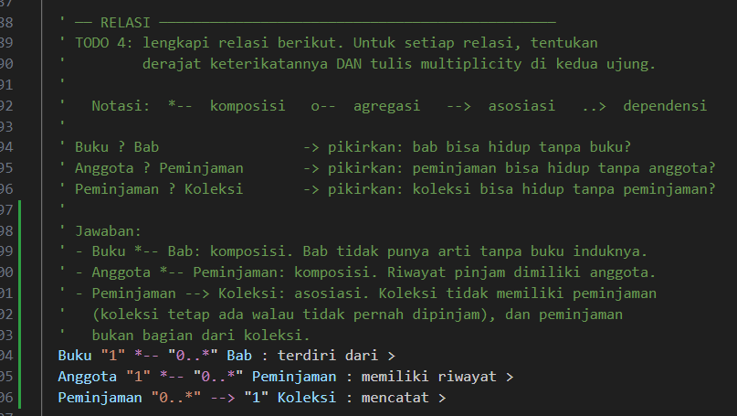

**Penjelasan:**
> `Buku "1" *-- "0..*" Bab` adalah komposisi, karena bab tidak punya arti tanpa buku. `Anggota "1" *-- "0..*" Peminjaman` adalah komposisi, karena riwayat pinjam dimiliki anggota. `Peminjaman "0..*" --> "1" Koleksi` adalah asosiasi, karena koleksi tidak memiliki peminjaman.

**TODO 5: Relasi `Koleksi <|-- Bab` yang salah**

* **Before** *(Kondisi awal / Relasi salah)*:

* **After** *(Kondisi akhir / Relasi diperbaiki)*:

**Penjelasan:**
> `Bab` bukan turunan `Koleksi`, melainkan bagian dari `Buku`. Relasi generalisasi tersebut dihapus.

**TODO 6: Relasi `PerpustakaanService`**

* **Before** *(Kondisi awal / Relasi belum ada)*:

* **After** *(Kondisi akhir / Relasi ditambahkan)*:

**Penjelasan:**
> `PerpustakaanService` memakai agregasi terhadap `Koleksi` dan `Anggota`, karena layanan hanya menyimpan referensi. Layanan juga memiliki dependensi ke `Peminjaman` karena membuatnya saat `pinjam()` dipanggil.

---

## 4. Kesimpulan

> Komposisi dipakai ketika bagian tidak punya arti tanpa induknya, seperti `Bab` pada `Buku`, dan bagian dibuat di dalam induk. Agregasi dipakai ketika bagian datang dari luar dan tetap hidup walau induknya dihapus, seperti `Mahasiswa` pada `Jurusan` dan `Koleksi` pada `PerpustakaanService`.
>
> Perbedaan utama Java dan PHP ada pada cara membatasi pembuatan objek bagian. Java bisa memakai nested class dengan constructor privat, sedangkan PHP hanya bisa mengandalkan konvensi.

