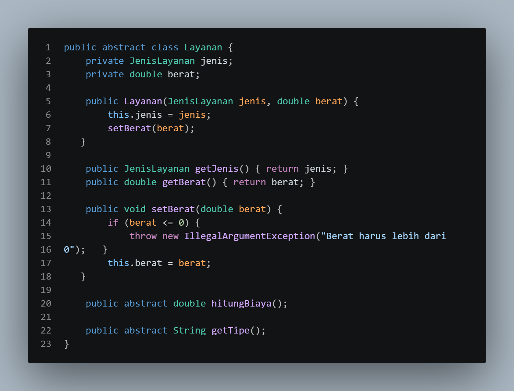
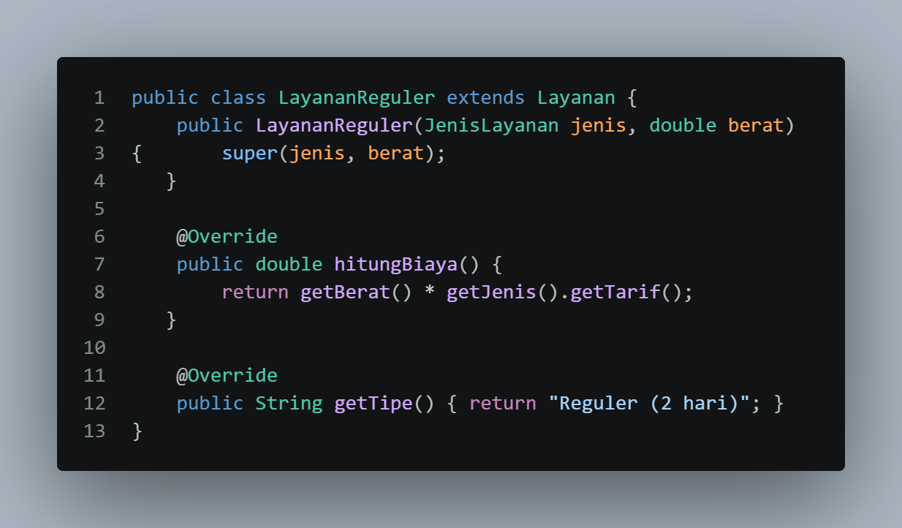

markdown
```
# LAPORAN UTS PRAKTIKUM PEMROGRAMAN BERBASIS OBJEK

| Informasi Proyek | Keterangan |
| :--- | :--- |
| **Mata Kuliah** | Pemrograman Berbasis Objek (PBO) |
| **Kelas** | A |
| **PJ** | Naila Putri Fahel |
| **Tema** | Sistem Pengelola Nota Laundry |
| **Tanggal** | 22 Oktober 2026 |
| **Nama** | Muhamad Aria Khalil Mirzahamzah |
| **NPM** | 4525210094 |

---

## Detail Pengerjaan & Anggota Kelompok

| Nama | NPM | Tugas / Fitur yang Dikerjakan |
| :--- | :--- | :--- |
| Mukhamad Akbar Raffael Ridho | 4525210085 | Polimorfisme - layananreguler.java |
| Vika Elda Lestari | 4525210088 | Abstract, enum - jenislayanan.java |
| Ardhelia Salsabila Al-bahri | 4525210092 | Relasi objek - Nota.java |
| Muhamad Aria Khalil Mirzahamzah | 4525210094 | Konstruktor, static, dan konstanta - Nota.java |
| Aulia Fachri | 4525210098 | Polimorfisme, Interface - diskon.java, main.java, pelanggan.java |
| Muhammad Faathir Madani | 4525210100 | Kelas, objek, dan enkapsulasi - Pelanggan.java |
| Rayza Aqsha Aditya | 4525210101 | Pewarisan - LayananExpress.java |

---

## Deskripsi Proyek

> Sistem Pengelola Nota Laundry adalah aplikasi berbasis Java CLI yang dirancang untuk mengelola transaksi pemesanan laundry secara terstruktur dan otomatis. Aplikasi ini bertujuan mempermudah perhitungan biaya pencucian berdasarkan jenis layanan (Reguler/Ekspres), status member pelanggan, dan diskon yang berlaku, serta mencetak nota transaksi secara sistematis.

**Daftar Fitur:**
1. Fitur Diskon
2. Fitur Layanan Express
3. Fitur Member Pelanggan

---

## 1. Implementasi Java

### 1.1. File: `Diskon.java`

**Penjelasan Kode:**

> File ini mendefinisikan `interface Diskon` yang menyediakan method `hitungDiskon(double total)` sebagai acuan dalam proses perhitungan potongan harga. Penerapan **Interface** memungkinkan logika diskon dibuat secara terpisah sehingga lebih fleksibel dan mudah dikembangkan.

**Screenshot Kode:**


### 1.2. File: `JenisLayanan.java`

**Penjelasan Kode:**

> File ini menggunakan `enum JenisLayanan` untuk menentukan pilihan paket laundry, yaitu Cuci Kering, Cuci Setrika, dan Setrika Saja, yang masing-masing memiliki tarif dasar. Penerapan **Enum** dan **Enkapsulasi** melalui atribut `private final` membantu membatasi akses data serta menjaga nilai tarif agar tetap konsisten.

**Screenshot Kode:**


### 1.3. File: `Layanan.java`

**Penjelasan Kode:**

> File ini mendefinisikan `abstract class Layanan` sebagai kelas dasar bagi berbagai jenis layanan laundry. Konsep **Abstract Class** digunakan untuk menyediakan struktur umum layanan, sedangkan **Enkapsulasi** diterapkan pada atribut `jenis` dan `berat`, termasuk validasi berat melalui method `setBerat`. Selain itu, terdapat method abstrak `hitungBiaya()` dan `getTipe()` yang wajib diimplementasikan oleh kelas turunannya.

**Screenshot Kode:**



### 1.4. File: `LayananExpress.java`

**Penjelasan Kode:**

> File ini merupakan kelas turunan dari `Layanan` yang digunakan untuk menangani layanan laundry dengan waktu pengerjaan lebih cepat. Konsep **Pewarisan (Inheritance)** memungkinkan kelas ini menggunakan struktur dari kelas induk, sedangkan **Konstanta (`static final`)** digunakan untuk menyimpan biaya tambahan layanan ekspres. Selain itu, **Polimorfisme (Overriding)** diterapkan dengan menyesuaikan implementasi method `hitungBiaya()` dan `getTipe()`.

**Screenshot Kode:**


### 1.5. File: `LayananReguler.java`

**Penjelasan Kode:**

> File ini merupakan turunan dari kelas `Layanan` yang menangani layanan laundry dengan waktu pengerjaan standar. Penerapan **Pewarisan** memungkinkan penggunaan atribut dan struktur dari kelas induk, sedangkan **Polimorfisme (Overriding)** digunakan untuk menyesuaikan method `hitungBiaya()` dan `getTipe()`. Biaya layanan reguler dihitung berdasarkan berat cucian dikalikan dengan tarif dasar yang berlaku.

**Screenshot Kode:**



### 1.6. File: `Nota.java`

**Penjelasan Kode:**

> File ini berfungsi untuk mengatur dan memproses transaksi laundry, mulai dari perhitungan biaya hingga pencetakan nota. Konsep **Relasi Objek (Asosiasi/Has-A)** diterapkan dengan menyimpan objek `Pelanggan` dan `Layanan`. Selain itu, variabel **`static`** digunakan untuk menghasilkan nomor nota secara otomatis, sedangkan **Konstanta** menyimpan nama toko agar nilainya tetap. Kelas ini juga bertanggung jawab menghitung total pembayaran berdasarkan layanan yang dipilih.

**Screenshot Kode:**


### 1.7. File: `Pelanggan.java`

**Penjelasan Kode:**

> File ini digunakan untuk menyimpan dan mengelola informasi pelanggan, meliputi `nama`, `noHp`, dan `member`. Konsep **Enkapsulasi** diterapkan dengan membatasi akses langsung terhadap atribut dan menyediakan `getter` untuk mengambil data. Kelas ini juga mengimplementasikan interface `Diskon` (**Interface Implementation**) untuk memberikan potongan harga sebesar 10% kepada pelanggan yang terdaftar sebagai member.

**Screenshot Kode:**


### 1.8. File: `Main.java`

**Penjelasan Kode:**

> File ini merupakan titik awal jalannya aplikasi yang mengatur keseluruhan proses transaksi laundry. Program menerima masukan pengguna secara interaktif menggunakan `Scanner`, kemudian menerapkan **Polimorfisme** dalam pemilihan objek `Layanan`. Selanjutnya, program membuat objek `Pelanggan` dan `Nota`, memproses pembayaran, serta menampilkan nota transaksi berdasarkan data yang telah dimasukkan.

**Screenshot Kode:**


### Output

**Hasil Running Program (Java):**

 

 

---

## 2. Kesimpulan

> Proyek **Sistem Pengelola Nota Laundry** berhasil mengimplementasikan prinsip-prinsip utama Pemrograman Berbasis Objek (PBO) berbasis Java CLI secara terstruktur. Penerapan **Enkapsulasi** menjaga integritas data entitas, **Pewarisan** dan **Polimorfisme** mempermudah fleksibilitas perhitungan variasi layanan (Reguler dan Express), sementara **Interface** serta **Enum** memaksimalkan kustomisasi diskon dan katalog paket. Secara keseluruhan, pembagian peran dalam kelompok berjalan efektif sehingga aplikasi mampu mengelola alur transaksi hingga pencetakan nota secara akurat dan otomatis.
```
